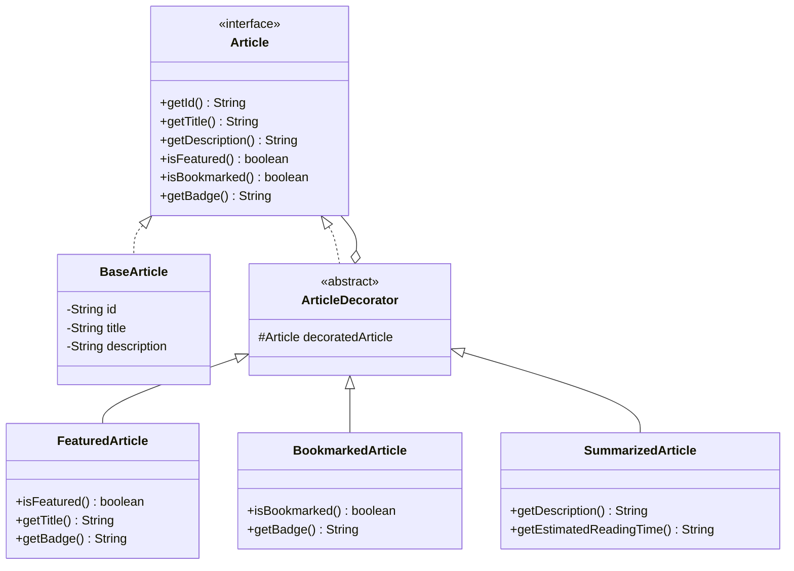
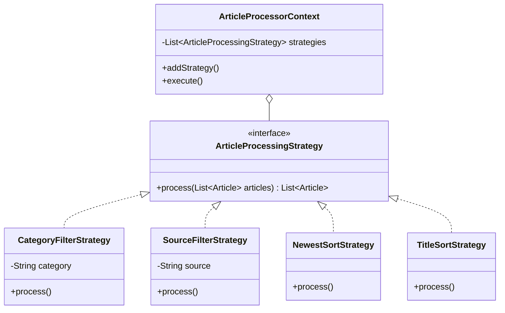

# Design Pattern Visualizer - Cẩm Nang Giải Trình 6 Mẫu Thiết Kế GoF

Dự án áp dụng chặt chẽ 6 mẫu thiết kế kinh điển của nhóm Gang of Four (GoF) vào đúng bài toán thu thập, xử lý và hiển thị tin tức.

## 1. Bản Đồ 6 Mẫu Thiết Kế Trong Ứng Dụng

| Mẫu Thiết Kế | Nhóm GoF | Thành phần trong Code | Vai trò giải quyết vấn đề |
| :--- | :--- | :--- | :--- |
| **Singleton** | Creational | `CacheManager` | Quản lý bộ đệm duy nhất lưu trữ tin tức trong RAM, đảm bảo thread-safe với `AtomicReference`. |
| **Factory Method** | Creational | `NewsParserFactory`, `NewsParser` | Đóng gói logic khởi tạo Parser theo loại nguồn (`RSS` hoặc `JSON` dự phòng) tuân thủ nguyên lý OCP. |
| **Adapter** | Structural | `RssEntryAdapter`, `JsonArticleAdapter` | Chuyển đổi đối tượng `SyndEntry` của thư viện ROME và JSON node thành `Article` chuẩn của hệ thống. |
| **Decorator** | Structural | `ArticleDecorator`, `FeaturedArticle`, `BookmarkedArticle`, `SummarizedArticle` | Mở rộng tính năng động cho bài viết (thêm badge, rút gọn tóm tắt, xếp chồng trạng thái) mà không kế thừa cứng. |
| **Strategy** | Behavioral | `ArticleProcessingStrategy`, `CategoryFilterStrategy`, `SourceFilterStrategy`, `SortStrategy` | Thay đổi thuật toán lọc bài viết và sắp xếp (mới nhất, cũ nhất, A-Z) linh hoạt khi người dùng chọn trên giao diện. |
| **Observer** | Behavioral | `NewsFeed` (Subject), `NewsObserver`, `NewsLogger` (Observer) | Bắn thông báo cập nhật tự động cho toàn bộ hệ thống khi có tin tức mới tải về từ RSS. |

## 2. Sơ Đồ Kiến Trúc Mẫu Thiết Kế (Mermaid Diagrams)

### Sơ đồ Decorator Pattern (Decorator Chaining):

### Sơ đồ Strategy Pattern (Filter & Sort):

## 3. Câu Hỏi Trọng Tâm Giáo Viên Thường Hỏi & Câu Trả Lời Chuẩn

1. **"Tại sao dùng Decorator thay vì thêm trường `isFeatured`, `isBookmarked` trực tiếp vào BaseArticle?"**
   - *Trả lời:* Nếu thêm trực tiếp vào BaseArticle, ta phải sửa đổi lớp hiện có mỗi khi có tính năng mới (vi phạm Open/Closed Principle). Với Decorator, ta có thể kết hợp tùy biến lúc runtime (ví dụ một bài viết vừa *Đã lưu*, vừa *Nổi bật*, vừa *Rút gọn tóm tắt*) bằng cách bọc lồng nhau `new BookmarkedArticle(new FeaturedArticle(article))`.

2. **"Strategy Pattern giúp ích gì cho chức năng lọc và sắp xếp?"**
   - *Trả lời:* Cho phép thay đổi thuật toán sắp xếp hoặc lọc theo tiêu chí bất kỳ tại runtime mà Controller không cần phải viết hàng loạt lệnh `if-else` lồng nhau. Việc bổ sung thuật toán sắp xếp mới chỉ cần tạo class implement `ArticleProcessingStrategy`.
