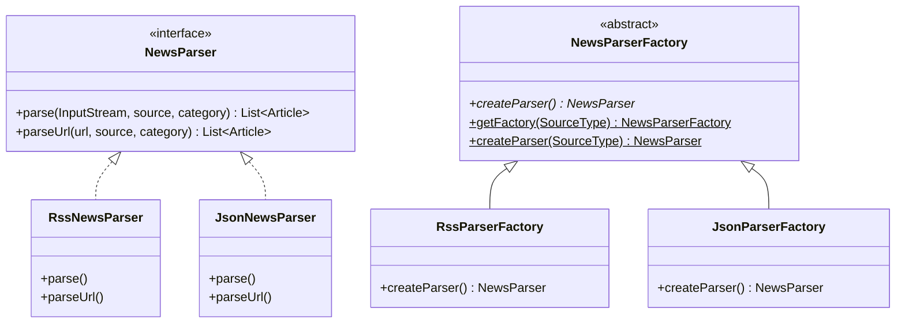
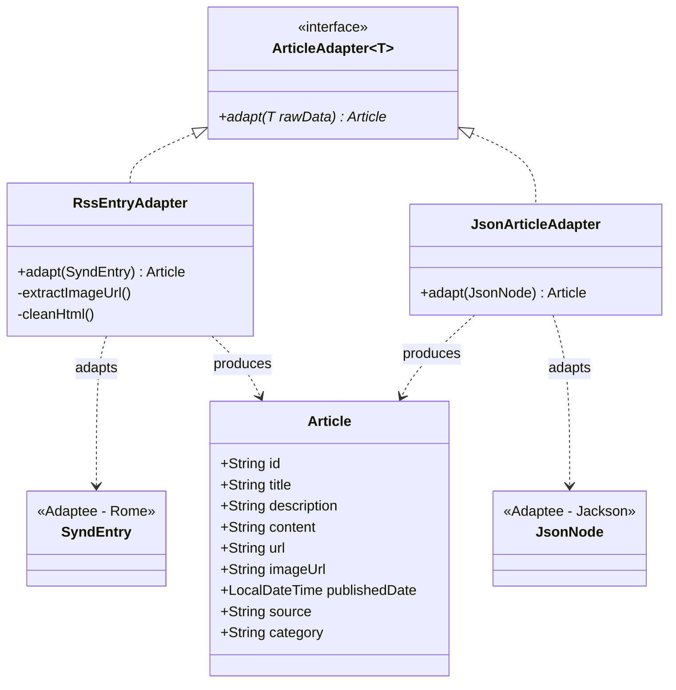
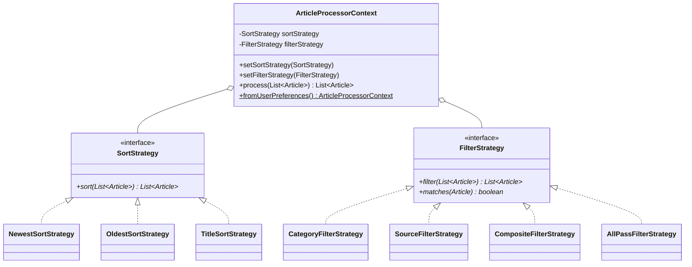
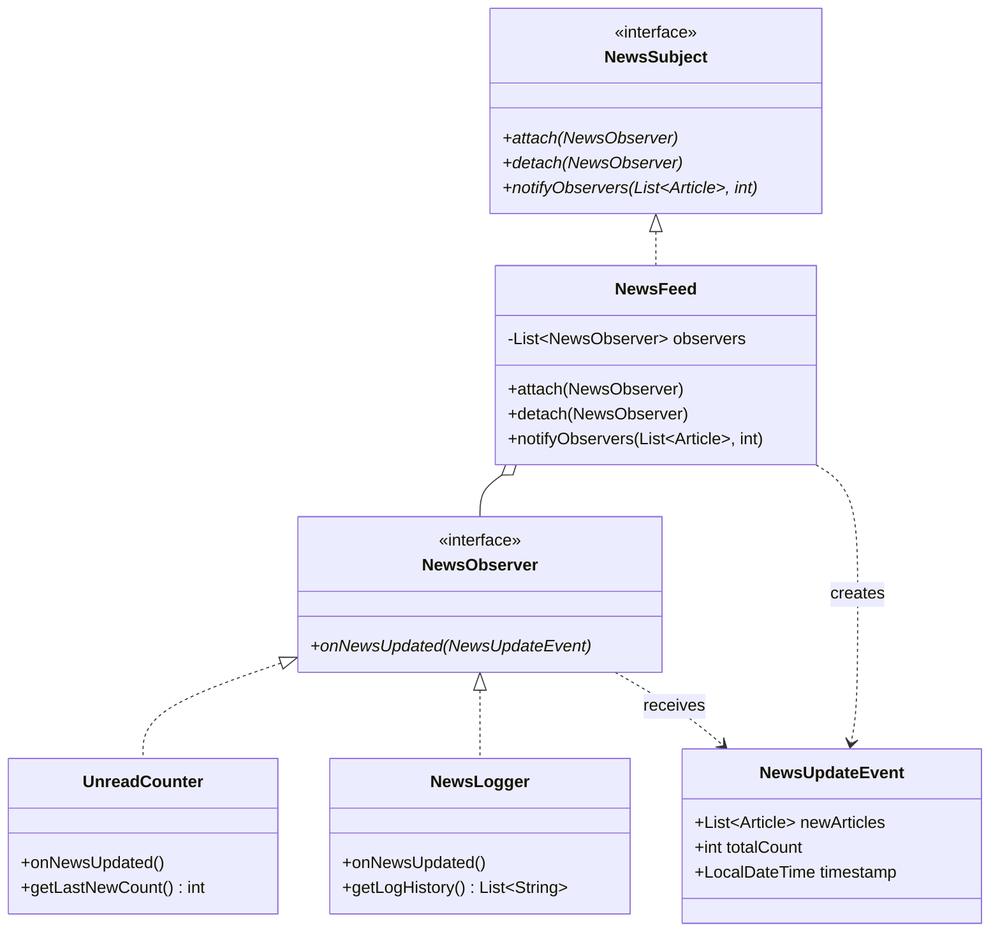
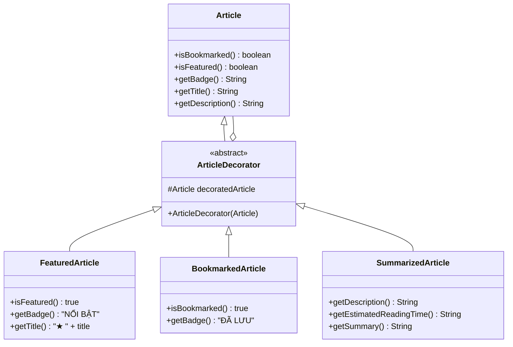
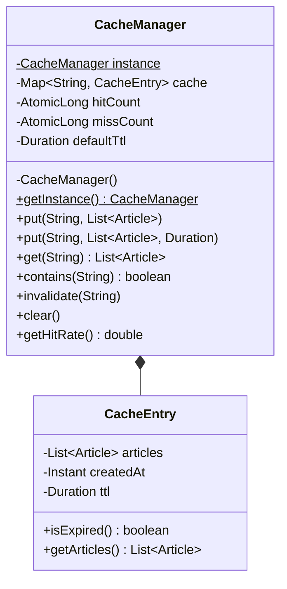

# BÁO CÁO ĐỒ ÁN MÔN MẪU THIẾT KẾ (DESIGN PATTERNS)
## ĐỀ TÀI: ỨNG DỤNG WEB ĐỌC BÁO ĐA NGUỒN (NEWS READER)

---

## I. TỔNG QUAN DỰ ÁN

### 1. Giới thiệu
Ứng dụng **News Reader** là hệ thống web đọc báo tin tức tổng hợp từ nhiều nguồn báo chí trực tuyến hàng đầu Việt Nam (VnExpress, Tuổi Trẻ) thông qua chuẩn RSS Feed, tích hợp chế độ đọc dữ liệu mẫu cục bộ (offline fallback). Hệ thống được xây dựng với mục tiêu chính là minh họa **đúng, rõ ràng và gắn liền với tính năng thực tế** của 6 mẫu thiết kế hướng đối tượng (GoF Design Patterns) bằng ngôn ngữ **Java thuần**, không dùng các cơ chế phụ thuộc vào Spring DI/Bean để thay thế mẫu.

### 2. Ngăn xếp công nghệ (Technology Stack)
- **Ngôn ngữ:** Java 17 (LTS).
- **Quản lý dự án & Build:** Apache Maven 3.9+.
- **Framework Web:** Spring Boot 3.3.4 (Spring MVC, Thymeleaf render phía server).
- **Thư viện RSS:** ROME 2.1.0 (phân tích RSS 2.0 XML).
- **Thư viện JSON:** Jackson Databind & JSR310 (xử lý dữ liệu fallback và lưu bookmarks).
- **Kiểm thử tự động:** JUnit 5 (Jupiter), AssertJ, MockMvc.
- **Lưu trữ:** Lưu trữ trong bộ nhớ kết hợp tệp tin phẳng JSON (`data/bookmarks.json`), không dùng cơ sở dữ liệu nặng.

### 3. Cấu trúc Package theo phân lớp chuẩn
```text
com.news
├── adapter     : Chuyển đổi dữ liệu thô (SyndEntry, JsonNode) về Article (Mẫu Adapter)
├── cache       : Quản lý bộ nhớ đệm tự viết thread-safe (Mẫu Singleton)
├── controller  : Tiếp nhận HTTP Request và render view Thymeleaf (Controller chỉ gọi Service)
├── decorator   : Bọc Article mở rộng tính năng động (Mẫu Decorator)
├── factory     : Tạo bộ phân tích tin tức theo loại nguồn (Mẫu Factory Method)
├── model       : Mô hình dữ liệu thực thể (Article, FeedSource)
├── observer    : Cơ chế thông báo sự kiện tin mới (Mẫu Observer)
├── service     : Nơi tích hợp và điều phối hoạt động giữa các mẫu thiết kế
└── strategy    : Thuật toán sắp xếp và lọc tin đổi được lúc runtime (Mẫu Strategy)
```

---

## II. CHI TIẾT 6 MẪU THIẾT KẾ ÁP DỤNG TRONG ĐỒ ÁN

---

### 1. MẪU FACTORY METHOD (Creational Pattern)

#### a. Bài toán gặp phải
Ứng dụng cần hỗ trợ thu thập tin tức từ nhiều định dạng nguồn khác nhau: nguồn trực tuyến chuẩn RSS XML (`https://.../rss/...`) và nguồn dữ liệu mẫu ngoại tuyến JSON (`src/main/resources/sample/news-sample.json`). Mỗi định dạng đòi hỏi quy trình đọc luồng dữ liệu, phân tích cú pháp và bóc tách khác hẳn nhau. Nếu trong `NewsService` dùng các câu lệnh `if-else` lồng nhau để trực tiếp `new RssNewsParser()` hay `new JsonNewsParser()`, code sẽ vi phạm nghiêm trọng nguyên lý Đóng/Mở (Open/Closed Principle) và phụ thuộc chặt vào các lớp cụ thể.

#### b. Vì sao chọn mẫu Factory Method
Factory Method chuyển giao trách nhiệm khởi tạo đối tượng cụ thể (`NewsParser`) cho các lớp con (`RssParserFactory`, `JsonParserFactory`). Lớp gọi (`NewsService`) chỉ làm việc với giao diện trừu tượng `NewsParserFactory` và `NewsParser`. Khi cần mở rộng hỗ trợ định dạng mới trong tương lai (ví dụ Atom Feed hay REST API), ta chỉ cần viết thêm một Creator và Product mới mà không cần sửa đổi mã nguồn xử lý nghiệp vụ hiện có.

#### c. Sơ đồ lớp (Class Diagram)


#### d. File / Lớp chứa mã nguồn
- `com.news.factory.NewsParser`: Product Interface định nghĩa hợp đồng parse dữ liệu.
- `com.news.factory.RssNewsParser`: Concrete Product phân tích RSS XML bằng thư viện Rome.
- `com.news.factory.JsonNewsParser`: Concrete Product phân tích file JSON bằng Jackson.
- `com.news.factory.NewsParserFactory`: Creator trừu tượng khai báo factory method `createParser()`.
- `com.news.factory.RssParserFactory`: Concrete Creator sinh ra `RssNewsParser`.
- `com.news.factory.JsonParserFactory`: Concrete Creator sinh ra `JsonNewsParser`.
- `com.news.factory.SourceType`: Enum định nghĩa loại nguồn (`RSS`, `JSON`).

#### e. Cách demo trên ứng dụng
1. Khi có kết nối mạng: Mở ứng dụng, `NewsService` gọi `NewsParserFactory.createParser(SourceType.RSS)` để nạp tin tức từ các đầu báo thật.
2. Khi ngắt kết nối mạng (hoặc giả lập mất mạng): Hệ thống bắt ngoại lệ mạng và tự động kích hoạt chế độ dự phòng, gọi `NewsParserFactory.createParser(SourceType.JSON)` đọc `sample/news-sample.json` và hiển thị thông báo dự phòng trên giao diện web.
3. Chạy unit test: `mvn test -Dtest=NewsParserFactoryTest`.

#### f. Ưu điểm & Nhược điểm
- **Ưu điểm:** Khử liên kết chặt chẽ giữa mã nguồn nghiệp vụ và các lớp phân tích cụ thể; tuân thủ Single Responsibility và Open/Closed Principle.
- **Nhược điểm:** Phải tạo thêm các lớp kế thừa Creator và Product, làm tăng số lượng lớp trong dự án.

---

### 2. MẪU ADAPTER (Structural Pattern)

#### a. Bài toán gặp phải
Dữ liệu trả về từ các nguồn ngoài không đồng nhất về mặt cấu trúc:
- Thư viện Rome trả về đối tượng `com.rometools.rome.feed.synd.SyndEntry` với ngày dạng `java.util.Date`, tiêu đề thô, mô tả chứa lẫn các thẻ HTML (`<a>`, ``, `&amp;`), ảnh nằm trong `enclosures` hoặc ẩn trong thẻ ``.
- File JSON fallback trả về cấu trúc cây `com.fasterxml.jackson.databind.JsonNode`.
- Trong khi đó, giao diện Thymeleaf và hệ thống nghiệp vụ chỉ chấp nhận một thực thể duy nhất là `com.news.model.Article`.

#### b. Vì sao chọn mẫu Adapter
Adapter đóng vai trò là "bộ chuyển đổi phích cắm", bọc đối tượng không tương thích (Adaptee) để biến đổi các trường dữ liệu, chuẩn hóa ngày tháng sang `LocalDateTime`, bóc tách URL ảnh, loại bỏ sạch mã HTML rác, và trả về đối tượng `Article` mà hệ thống mong đợi (Target).

#### c. Sơ đồ lớp (Class Diagram)


#### d. File / Lớp chứa mã nguồn
- `com.news.adapter.ArticleAdapter<T>`: Target Interface với phương thức `adapt(T rawData)`.
- `com.news.adapter.RssEntryAdapter`: Concrete Adapter bọc `SyndEntry` của Rome, bóc tách ảnh đại diện và lọc sạch HTML.
- `com.news.adapter.JsonArticleAdapter`: Concrete Adapter bọc `JsonNode` của Jackson chuyển thành `Article`.

#### e. Cách demo trên ứng dụng
1. Xem bất kỳ bài viết nào từ VnExpress hoặc Tuổi Trẻ trên trang chủ: Tiêu đề không bị lỗi ký tự HTML entities, đoạn tóm tắt sạch đẹp không chứa thẻ `<a href...>` hay ``, ảnh thumbnail hiển thị chính xác ở góc card.
2. Mở trang xem chi tiết `/article/{id}`: Toàn bộ thông tin được format chuẩn chỉnh.
3. Chạy unit test: `mvn test -Dtest=ArticleAdapterTest`.

#### f. Ưu điểm & Nhược điểm
- **Ưu điểm:** Tách biệt hoàn toàn việc phân tích và xử lý chuỗi HTML bẩn khỏi mô hình dữ liệu lõi; tái sử dụng các thư viện bên thứ 3 mà không cần sửa mã nguồn thư viện.
- **Nhược điểm:** Tăng chi phí trung gian tạo đối tượng trong bộ nhớ khi chuyển đổi số lượng lớn bài viết.

---

### 3. MẪU STRATEGY (Behavioral Pattern)

#### a. Bài toán gặp phải
Trên giao diện trang chủ, người dùng cần:
- Lọc bài viết theo Chuyên mục (Thời sự, Kinh doanh, Công nghệ, Thể thao, Giải trí).
- Lọc bài viết theo Nguồn báo (VnExpress, Tuổi Trẻ).
- Lọc kết hợp đồng thời cả Chuyên mục và Nguồn báo.
- Sắp xếp bài viết theo: Mới nhất, Cũ nhất, hoặc Theo tiêu đề bảng chữ cái (A-Z).
Nếu viết tất cả điều kiện này bằng các khối `if/else` hoặc `switch/case` trong controller hay service, mã nguồn sẽ trở nên cồng kềnh, khó bảo trì và không thể mở rộng thuật toán mới lúc runtime.

#### b. Vì sao chọn mẫu Strategy
Strategy đóng gói mỗi thuật toán sắp xếp (`SortStrategy`) và thuật toán lọc (`FilterStrategy`) vào các lớp riêng biệt. Lớp ngữ cảnh `ArticleProcessorContext` nắm giữ tham chiếu đến Strategy và cho phép **thay đổi linh hoạt (swap) ngay tại thời điểm chạy (runtime)** dựa vào lựa chọn của người dùng qua Query Parameter.

#### c. Sơ đồ lớp (Class Diagram)


#### d. File / Lớp chứa mã nguồn
- `com.news.strategy.SortStrategy`: Interface chiến lược sắp xếp.
- `com.news.strategy.NewestSortStrategy`: Sắp xếp ngày giảm dần (mới nhất).
- `com.news.strategy.OldestSortStrategy`: Sắp xếp ngày tăng dần (cũ nhất).
- `com.news.strategy.TitleSortStrategy`: Sắp xếp theo thứ tự chữ cái tiếng Việt A-Z với `Collator`.
- `com.news.strategy.FilterStrategy`: Interface chiến lược lọc.
- `com.news.strategy.CategoryFilterStrategy`: Lọc theo chuyên mục.
- `com.news.strategy.SourceFilterStrategy`: Lọc theo nguồn báo.
- `com.news.strategy.CompositeFilterStrategy`: Kết hợp đồng thời nhiều bộ lọc (AND).
- `com.news.strategy.AllPassFilterStrategy`: Bộ lọc mặc định cho qua toàn bộ bài viết.
- `com.news.strategy.ArticleProcessorContext`: Ngữ cảnh điều phối và thực thi thuật toán.

#### e. Cách demo trên ứng dụng
1. Trên thanh công cụ trang chủ, chọn Chuyên mục = "Công nghệ", Nguồn = "VnExpress", Sắp xếp = "Theo tiêu đề (A-Z)" -> Nhấn "Áp dụng".
2. Hệ thống chuyển đổi ngay sang `CompositeFilterStrategy` và `TitleSortStrategy`, kết quả hiển thị đúng các bài công nghệ từ VnExpress được sắp xếp A-Z.
3. Chạy unit test kiểm tra đổi chiến lược lúc runtime: `mvn test -Dtest=StrategyPatternTest`.

#### f. Ưu điểm & Nhược điểm
- **Ưu điểm:** Dễ dàng bổ sung thuật toán sắp xếp hoặc lọc mới (ví dụ sắp xếp theo độ hot, lọc theo từ khóa); loại bỏ triệt để các cấu trúc rẽ nhánh phức tạp.
- **Nhược điểm:** Khách hàng (Context/Controller) phải nhận biết và lựa chọn chiến lược phù hợp.

---

### 4. MẪU OBSERVER (Behavioral Pattern)

#### a. Bài toán gặp phải
Khi người dùng bấm nút "Làm mới", hệ thống tải tin tức mới từ các nguồn RSS. Nhiều thành phần khác nhau cần nhận biết sự kiện này để phản ứng:
- Bộ đếm tin mới (`UnreadCounter`) cần tính toán số lượng bài viết mới xuất hiện để hiển thị thông báo chào mừng người dùng.
- Trình ghi nhật ký (`NewsLogger`) cần lưu lại vết lịch sử (thời gian, số tin cập nhật, tiêu đề bài viết mới) để kiểm toán.
Nếu `NewsService` gọi trực tiếp từng lớp này, `NewsService` sẽ bị phụ thuộc chặt chẽ và không thể tùy biến thêm các bên nhận tin mới (như gửi email, push notification).

#### b. Vì sao chọn mẫu Observer
Observer xây dựng mối quan hệ một-nhiều (one-to-many) lỏng lẻo. `NewsFeed` là Subject phát thông báo khi có tin tức mới, các đối tượng `UnreadCounter` và `NewsLogger` đóng vai trò là Observer đăng ký (attach) vào Subject. Khi có tin mới, Subject chỉ việc gọi `notifyObservers()`, mọi Observer đã đăng ký sẽ tự động cập nhật mà không làm thay đổi mã nguồn của Subject.

#### c. Sơ đồ lớp (Class Diagram)


#### d. File / Lớp chứa mã nguồn
- `com.news.observer.NewsSubject`: Interface khai báo `attach()`, `detach()`, `notifyObservers()`.
- `com.news.observer.NewsFeed`: Concrete Subject quản lý danh sách Observer thread-safe (`CopyOnWriteArrayList`).
- `com.news.observer.NewsObserver`: Interface cho các thành phần lắng nghe sự kiện tin mới.
- `com.news.observer.UnreadCounter`: Concrete Observer đếm số bài viết mới phát hiện trong đợt cập nhật.
- `com.news.observer.NewsLogger`: Concrete Observer ghi log chi tiết và lưu lịch sử các đợt làm mới.
- `com.news.observer.NewsUpdateEvent`: Đối tượng chứa dữ liệu sự kiện cập nhật.

#### e. Cách demo trên ứng dụng
1. Trên giao diện trang chủ, nhấn nút **"🔄 Làm mới"**.
2. Trang tải lại và hiện banner thông báo màu xanh: *"Làm mới thành công! [Observer] UnreadCounter ghi nhận X tin tức mới..."*.
3. Kiểm tra console terminal: Nhìn thấy log từ `[Observer:NewsLogger] Cập nhật tin tức: X tin mới, tổng cộng: Y tin. Một số tiêu đề mới: [...]`.
4. Chạy unit test: `mvn test -Dtest=ObserverPatternTest`.

#### f. Ưu điểm & Nhược điểm
- **Ưu điểm:** Khớp nối lỏng lẻo giữa Subject và Observer; dễ dàng thêm bớt người theo dõi tại thời điểm chạy mà không ảnh hưởng hệ thống.
- **Nhược điểm:** Thứ tự nhận thông báo giữa các Observer không được đảm bảo cố định.

---

### 5. MẪU DECORATOR (Structural Pattern)

#### a. Bài toán gặp phải
Bài viết tin tức (`Article`) cần có thêm các đặc tính nâng cao tùy theo trạng thái hoặc ngữ cảnh hiển thị:
- Bài viết nổi bật: cần có biểu tượng `★` trên tiêu đề và huy hiệu `NỔI BẬT`.
- Bài viết được người dùng lưu: cần có huy hiệu `✓ ĐÃ LƯU` và cờ `bookmarked = true`.
- Bài viết hiển thị trên danh sách card: cần có đoạn mô tả tóm tắt ngắn gọn và tính toán thời gian ước lượng đọc (ví dụ: `⏱ ~2 phút đọc • ...`).
Nếu dùng kế thừa truyền thống để tạo các lớp con kết hợp (`FeaturedBookmarkedArticle`, `SummarizedFeaturedBookmarkedArticle`...), hệ thống sẽ rơi vào tình trạng **bùng nổ số lượng lớp con (class explosion)**.

#### b. Vì sao chọn mẫu Decorator
Decorator cho phép bổ sung hành vi và thuộc tính cho đối tượng `Article` một cách **năng động và linh hoạt lúc chạy** bằng cách bọc đối tượng gốc trong một đối tượng Decorator khác. Các Decorator có thể được **xếp chồng (stacking)** tùy ý trên cùng một bài viết (ví dụ: vừa tóm tắt, vừa nổi bật, vừa đã lưu) mà không sửa đổi lớp `Article` gốc.

#### c. Sơ đồ lớp (Class Diagram)


#### d. File / Lớp chứa mã nguồn
- `com.news.decorator.ArticleDecorator`: Lớp trừu tượng kế thừa `Article` và chứa tham chiếu delegate `protected final Article decoratedArticle`.
- `com.news.decorator.FeaturedArticle`: Concrete Decorator bổ sung cờ nổi bật, gắn nhãn `NỔI BẬT` và tiền tố sao `★`.
- `com.news.decorator.BookmarkedArticle`: Concrete Decorator đánh dấu trạng thái đã lưu `isBookmarked() = true` và nhãn `ĐÃ LƯU`.
- `com.news.decorator.SummarizedArticle`: Concrete Decorator cắt gọt văn bản súc tích và tính toán thời gian đọc.
- `com.news.service.BookmarkService`: Quản lý lưu trữ danh sách bài viết đã đánh dấu ra file `data/bookmarks.json`.

#### e. Cách demo trên ứng dụng
1. Tại bất kỳ bài viết nào trên trang chủ, bấm vào nút **"☆ Lưu tin"**. Nút chuyển sang trạng thái **"★ Đã lưu"**, huy hiệu `✓ ĐÃ LƯU` xuất hiện trên card bài viết.
2. Bấm vào menu **"⭐ Đã lưu"** trên thanh điều hướng: Trang `/bookmarks` hiển thị danh sách các bài viết được bọc bởi `BookmarkedArticle`.
3. Khởi động lại ứng dụng hoặc kiểm tra file `data/bookmarks.json`: Dữ liệu vẫn được giữ nguyên đầy đủ.
4. Chạy unit test kiểm tra xếp chồng Decorator: `mvn test -Dtest=DecoratorPatternTest,BookmarkServiceTest`.

#### f. Ưu điểm & Nhược điểm
- **Ưu điểm:** Linh hoạt hơn kế thừa rất nhiều; cho phép kết hợp đa dạng các tính năng bổ sung; tuân thủ nguyên lý Single Responsibility.
- **Nhược điểm:** Tạo ra nhiều đối tượng nhỏ bọc nhau trong bộ nhớ; việc gỡ bỏ một tầng decorator ở giữa chuỗi bọc tương đối phức tạp.

---

### 6. MẪU SINGLETON (Creational Pattern)

#### a. Bài toán gặp phải
Trong một ứng dụng đọc báo tin tức:
- Nếu mỗi HTTP Request từ người dùng (lọc, sắp xếp, xem danh mục) đều kích hoạt tải lại toàn bộ các nguồn RSS qua mạng, ứng dụng sẽ rất chậm, tiêu tốn băng thông và có nguy cơ bị máy chủ báo chí chặn IP (lỗi HTTP 429 Too Many Requests).
- Cần có một thành phần quản lý bộ nhớ đệm (Cache) tập trung, dùng chung trong toàn bộ ứng dụng, có tính năng tự động hết hạn (TTL) và phải **hoàn toàn an toàn trong môi trường đa luồng (thread-safe)** khi nhiều người dùng cùng truy cập đồng thời.

#### b. Vì sao chọn mẫu Singleton
Singleton đảm bảo rằng **chỉ có duy nhất một thể hiện của lớp `CacheManager`** tồn tại trong toàn bộ vòng đời của ứng dụng máy ảo Java (JVM), cung cấp một điểm truy cập toàn cục `CacheManager.getInstance()`. Nhờ đó, tất cả các luồng xử lý đều đọc và ghi dữ liệu tin tức trên cùng một vùng bộ nhớ đệm nhất quán.

#### c. Sơ đồ lớp (Class Diagram)


#### d. Kỹ thuật cài đặt & File chứa mã nguồn
- `com.news.cache.CacheManager`:
  - Áp dụng kỹ thuật **Double-Checked Locking** với biến `private static volatile CacheManager instance`.
  - Từ khóa `volatile` ngăn ngừa hiện tượng Instruction Reordering (đảo trật tự lệnh CPU) trong kiến trúc bộ nhớ Java.
  - Khối `synchronized (CacheManager.class)` chỉ khóa khi `instance == null`, tối ưu hóa tối đa hiệu năng cho các lần truy cập tiếp theo.
  - `private CacheManager()` ngăn chặn việc gọi `new CacheManager()` từ bên ngoài.
  - Sử dụng `ConcurrentHashMap` lưu trữ các `CacheEntry` đảm bảo thread-safe.
- `com.news.cache.CacheEntry`: Gói danh sách bài viết kèm thời điểm tạo và thời gian sống (TTL).

#### e. Cách demo trên ứng dụng
1. Khi tải trang lần đầu, hệ thống lấy tin từ RSS và lưu vào `CacheManager`.
2. Khi người dùng thực hiện lọc theo chuyên mục hoặc chuyển đổi sắp xếp, hệ thống lấy ngay danh sách từ cache mà không gọi mạng, thời gian phản hồi gần như tức thì (< 5ms).
3. Khi bấm "Làm mới", cache được cập nhật đồng bộ.
4. Chạy unit test kiểm tra đa luồng (50 luồng đồng thời gọi `getInstance()`): `mvn test -Dtest=CacheManagerTest`.

#### f. Ưu điểm & Nhược điểm
- **Ưu điểm:** Tiết kiệm tài nguyên bộ nhớ; truy cập nhất quán trên toàn hệ thống; tăng tốc độ phản hồi web rõ rệt; kiểm soát chặt chẽ việc khởi tạo đối tượng.
- **Nhược điểm:** Có thể gây khó khăn khi viết unit test độc lập nếu trạng thái cache không được làm sạch (`clear()`) giữa các test case.

---

## III. BẢNG TỔNG HỢP 6 MẪU THIẾT KẾ ĐÃ ÁP DỤNG

| STT | Tên Mẫu Thiết Kế | Phân Loại GoF | Các Lớp / File Mã Nguồn Đại Diện | Tính Năng Thực Tế Trong Ứng Dụng |
| :---: | :--- | :--- | :--- | :--- |
| **1** | **Factory Method** | Khởi tạo (Creational) | `NewsParserFactory`, `RssParserFactory`, `JsonParserFactory`, `NewsParser`, `RssNewsParser`, `JsonNewsParser` | Tạo đúng parser theo loại nguồn (RSS XML hoặc file mẫu JSON). |
| **2** | **Adapter** | Cấu trúc (Structural) | `ArticleAdapter`, `RssEntryAdapter`, `JsonArticleAdapter` | Chuyển đổi dữ liệu thô `SyndEntry` và `JsonNode` về lớp thực thể `Article` chuẩn hóa; làm sạch mã HTML và tách ảnh đại diện. |
| **3** | **Strategy** | Hành vi (Behavioral) | `SortStrategy` (`Newest`, `Oldest`, `Title`), `FilterStrategy` (`Category`, `Source`, `Composite`, `AllPass`), `ArticleProcessorContext` | Cho phép người dùng hoán đổi thuật toán lọc tin và sắp xếp linh hoạt lúc runtime trên giao diện web. |
| **4** | **Observer** | Hành vi (Behavioral) | `NewsSubject`, `NewsFeed`, `NewsObserver`, `UnreadCounter`, `NewsLogger`, `NewsUpdateEvent` | Tự động thông báo cho bộ đếm tin mới và trình ghi log khi người dùng bấm nút "Làm mới tin". |
| **5** | **Decorator** | Cấu trúc (Structural) | `ArticleDecorator`, `FeaturedArticle`, `BookmarkedArticle`, `SummarizedArticle`, `BookmarkService` | Bọc bài viết để thêm huy hiệu "NỔI BẬT", trạng thái "ĐÃ LƯU" (lưu ra file JSON), và tạo tóm tắt kèm ước lượng thời gian đọc. |
| **6** | **Singleton** | Khởi tạo (Creational) | `CacheManager`, `CacheEntry` | Quản lý bộ nhớ đệm duy nhất, thread-safe (Double-Checked Locking), lưu trữ tin đã tải và hỗ trợ thời gian hết hạn (TTL). |

---

## IV. HƯỚNG DẪN KIỂM TRA & BẢO VỆ ĐỒ ÁN VỚI GIÁO VIÊN

### 1. Lệnh kiểm thử toàn diện
Chạy lệnh kiểm thử Maven để xác nhận toàn bộ 31 bài kiểm thử tự động của 6 mẫu thiết kế đều vượt qua:
```bash
mvn clean verify
```
Kết quả mong đợi: `BUILD SUCCESS`, `Tests run: 31, Failures: 0, Errors: 0, Skipped: 0`.

### 2. Khởi chạy ứng dụng
```bash
mvn spring-boot:run
```
Mở trình duyệt truy cập: [http://localhost:8080](http://localhost:8080) (hoặc `--server.port=8081` nếu cổng 8080 bị tiến trình khác chiếm dụng).

### 3. Kịch bản trình bày mẫu thiết kế (5 phút)
1. **Trang chủ:** Chỉ vào các bài viết có gắn nhãn `NỔI BẬT` và tiêu đề có `★` -> Giải thích mẫu **Decorator** (`FeaturedArticle`).
2. **Thanh bộ lọc & sắp xếp:** Đổi chuyên mục sang "Công nghệ", sắp xếp theo "Tiêu đề (A-Z)" -> Nhấn "Áp dụng", chỉ vào code `ArticleProcessorContext` giải thích mẫu **Strategy**.
3. **Nút Làm mới:** Nhấn nút "Làm mới", chỉ vào thông báo số tin mới và màn hình console hiển thị log -> Giải thích mẫu **Observer** (`NewsFeed` thông báo `UnreadCounter` và `NewsLogger`).
4. **Lưu tin:** Bấm "☆ Lưu tin" ở 1 bài viết, chuyển sang tab "⭐ Đã lưu" -> Giải thích mẫu **Decorator** (`BookmarkedArticle`) và mở file `data/bookmarks.json` để chỉ dữ liệu được lưu bền vững.
5. **Hiệu năng & Cache:** Mở lớp `CacheManager.java` -> Giải thích mẫu **Singleton**, chỉ rõ kỹ thuật Double-Checked Locking và `ConcurrentHashMap`.
6. **Xử lý nguồn tin:** Mở package `factory` và `adapter` -> Giải thích cách `NewsParserFactory` tạo parser và `RssEntryAdapter` làm sạch dữ liệu từ RSS về `Article`.
