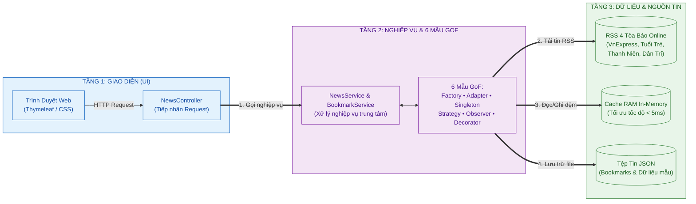

# CẨM NANG THUYẾT TRÌNH BẢO VỆ ĐỒ ÁN MẪU THIẾT KẾ (DESIGN PATTERNS)
## ĐỀ TÀI: WEBSITE ĐỌC BÁO ĐA NGUỒN (NEWS READER)
**Framework:** Spring Boot 3.3.4 (Java 17) • **Frontend:** Thymeleaf (SSR) + Vanilla CSS • **Kiến trúc:** 3 Tầng & 6 Mẫu GoF

---

## MỤC LỤC
1. [Lời Mở Đầu & Tổng Quan Dự Án](#1-lời-mở-đầu--tổng-quan-dự-án)
2. [Kiến Trúc 3 Tầng & Sơ Đồ Luồng Hoạt Động](#2-kiến-trúc-3-tầng--sơ-đồ-luồng-hoạt-động)
3. [Trình Bày Phần Giao Diện (Frontend & UX)](#3-trình-bày-phần-giao-diện-frontend--ux)
4. [Chi Tiết 6 Mẫu Thiết Kế GoF (Lý Thuyết - Lý Do - Lợi Ích - Dẫn Chứng Code)](#4-chi-tiết-6-mẫu-thiết-kế-gof)
   - [Mẫu 1: Factory Method (Khởi tạo bộ đọc tin)](#mẫu-1-factory-method-creational-pattern)
   - [Mẫu 2: Adapter (Bộ chuyển đổi & làm sạch dữ liệu)](#mẫu-2-adapter-structural-pattern)
   - [Mẫu 3: Singleton (Bộ nhớ đệm duy nhất CacheManager)](#mẫu-3-singleton-creational-pattern)
   - [Mẫu 4: Strategy (Chiến lược lọc & sắp xếp động)](#mẫu-4-strategy-behavioral-pattern)
   - [Mẫu 5: Observer (Tự động thông báo sự kiện tin mới)](#mẫu-5-observer-behavioral-pattern)
   - [Mẫu 6: Decorator (Bọc mở rộng tính năng bài viết)](#mẫu-6-decorator-structural-pattern)
5. [Dây Chuyền 6 Mẫu Phối Hợp Hoạt Động](#5-dây-chuyền-6-mẫu-phối-hợp-hoạt-động)
6. [Kịch Bản Demo Trực Tiếp Trên Máy Chiếu (4 Bước Thực Chiến)](#6-kịch-bản-demo-trực-tiếp-trên-máy-chiếu)
7. [Bộ Câu Hỏi Vấn Đáp (Q&A) Thầy Cô Thường Hỏi & Câu Trả Lời Chuẩn](#7-bộ-câu-hỏi-vấn-đáp-qa-thường-gặp)

---

## 1. LỜI MỞ ĐẦU & TỔNG QUAN DỰ ÁN

### Lời thoại mở đầu (Nói trong 1 phút):
> *"Kính thưa Thầy/Cô và các bạn, đề tài của nhóm em là **Ứng dụng Web Đọc Báo Đa Nguồn (News Reader)**.  
> Ứng dụng giải quyết nhu cầu thực tế: Người dùng muốn đọc tin tức tổng hợp từ nhiều tòa soạn báo lớn tại Việt Nam (như VnExpress, Tuổi Trẻ, Thanh Niên, Dân Trí) trên cùng một giao diện duy nhất, tốc độ phản hồi nhanh, không bị quảng cáo rác và có thể lưu tin đọc lại.  
> Điểm đặc biệt của đồ án là nhóm không lạm dụng các cơ chế tự động của Spring Framework để né tránh mẫu, mà **tự cài đặt chuẩn mực 6 mẫu thiết kế GoF (Gang of Four) bằng Java thuần**, áp dụng xuyên suốt vào các bài toán: nạp tin đa định dạng, làm sạch mã HTML, bộ đệm tối ưu tốc độ, lọc tin động, bắn thông báo và trang trí bài viết."*

### Ngăn xếp công nghệ (Technology Stack):
- **Ngôn ngữ:** Java 17 LTS (hiện đại, ổn định).
- **Backend:** Spring Boot 3.3.4 (Spring Web MVC).
- **Frontend:** Thymeleaf (Server-Side Rendering) kết hợp Vanilla HTML5/CSS3 theo phong cách báo chí hiện đại (Modern Editorial UI).
- **Thư viện ngoài:** ROME 2.1.0 (phân tích luồng RSS), Jackson (xử lý JSON fallback và lưu bookmarks).
- **Kiểm thử tự động:** JUnit 5 với đầy đủ unit test cho từng mẫu thiết kế.

---

## 2. KIẾN TRÚC 3 TẦNG & SƠ ĐỒ LUỒNG HOẠT ĐỘNG

Dự án tuân thủ nghiêm ngặt **Kiến trúc 3 tầng (3-Tier Architecture)** từ Trái sang Phải:



### Phân công trách nhiệm từng tầng:
1. **Tầng 1 - Presentation Tier:** [NewsController.java](file:///c:/Users/HELLO/OneDrive/Desktop/DoAnMauTK/src/main/java/com/news/controller/NewsController.java) chỉ làm nhiệm vụ tiếp nhận HTTP request từ người dùng, gọi Service và truyền Model vào giao diện Thymeleaf, **hoàn toàn không chứa mã xử lý nghiệp vụ**.
2. **Tầng 2 - Business Logic Tier:** [NewsService.java](file:///c:/Users/HELLO/OneDrive/Desktop/DoAnMauTK/src/main/java/com/news/service/NewsService.java) và [BookmarkService.java](file:///c:/Users/HELLO/OneDrive/Desktop/DoAnMauTK/src/main/java/com/news/service/BookmarkService.java) giữ vai trò nhạc trưởng điều phối 6 mẫu thiết kế GoF để xử lý tin tức.
3. **Tầng 3 - Data Tier:** Quản lý dữ liệu từ 3 nguồn: Nguồn báo mạng RSS qua giao thức HTTP, Bộ nhớ đệm RAM tốc độ cao và Tệp phẳng JSON (`data/bookmarks.json`) lưu trữ bền vững.

---

## 3. TRÌNH BÀY PHẦN GIAO DIỆN (FRONTEND & UX)

Giao diện được thiết kế theo quy chuẩn báo chí điện tử hiện đại, tập trung vào 3 trang màn hình chính:

### a. Trang chủ (`/` - file [index.html](file:///c:/Users/HELLO/OneDrive/Desktop/DoAnMauTK/src/main/resources/templates/index.html)):
- **Khu vực Tiêu điểm (Spotlight Hero 3 cột):** Bài viết quan trọng nhất xếp bên trái với hình ảnh kích thước lớn; 2 bài phụ nằm bên phải. Cụm tin tiêu điểm này tự động thay đổi ăn khớp khi người dùng lọc theo bất kỳ chuyên mục nào.
- **Thanh công cụ lọc đa năng:** Người dùng có thể lọc theo **Nguồn báo** (VnExpress, Tuổi Trẻ, Thanh Niên, Dân Trí), **Chuyên mục** (Thời sự, Kinh doanh, Công nghệ, Thể thao, Giải trí), **Sắp xếp** (Mới nhất, Cũ nhất, A-Z), và nút **"🔄 Làm mới tin"**.
- **Lưới bài viết (Article Grid):** Bố cục card báo chí chỉn chu, hiển thị ảnh thumbnail, thẻ chuyên mục, thời gian đọc ước tính (`⏱ ~2 phút đọc`) và nút tương tác nhanh **"☆ Lưu tin"**.

### b. Trang xem chi tiết bài viết (`/article/{id}` - file [detail.html](file:///c:/Users/HELLO/OneDrive/Desktop/DoAnMauTK/src/main/resources/templates/detail.html)):
- **Chế độ đọc tập trung (Reader Mode):** Giao diện tinh gọn, loại bỏ mọi thành phần gây xao nhãng.
- **Thanh công cụ chỉnh cỡ chữ (Font-Size Switcher):** Cung cấp 3 nút bấm **A- / A / A+** cho phép độc giả tùy chỉnh kích thước chữ văn bản to nhỏ ngay lập tức mà không cần zoom toàn bộ trình duyệt.
- **Cột bên (Sidebar):** Tự động gợi ý 4 bài viết liên quan cùng chuyên mục và danh sách bài viết thịnh hành.

### c. Trang tin đã lưu (`/bookmarks` - file [bookmarks.html](file:///c:/Users/HELLO/OneDrive/Desktop/DoAnMauTK/src/main/resources/templates/bookmarks.html)):
- Quản lý những bài viết độc giả đã bấm lưu. Dữ liệu được ghi ra file `data/bookmarks.json`, đóng trình duyệt hay khởi động lại máy chủ vẫn giữ nguyên.

---

## 4. CHI TIẾT 6 MẪU THIẾT KẾ GOF

---

### MẪU 1: FACTORY METHOD (Creational Pattern)

#### 1. Lý thuyết sơ qua (Ý tưởng đời thường):
Giống như **Máy pha cà phê tự động**: Khách bấm nút chọn món nào thì máy nhả ra đúng món đó (chọn Espresso nhả Espresso, chọn Latte nhả Latte). Khách hàng không cần biết bên trong máy xay hạt, đun nước ra sao.

#### 2. Tại sao áp dụng vào dự án này?
Hệ thống cần đọc tin tức từ 2 định dạng khác nhau:
- Đọc tin trực tuyến qua chuẩn **RSS XML** từ các báo điện tử.
- Đọc tin ngoại tuyến từ file **JSON mẫu** (`news-sample.json`) khi máy chủ bị mất mạng hoặc nguồn báo lỗi.  
Nếu không dùng mẫu này, trong `NewsService` sẽ phải viết các câu lệnh `if-else` lộn xộn để trực tiếp gọi `new RssNewsParser()` hay `new JsonNewsParser()`. Khi cần mở rộng thêm nguồn mới (ví dụ API báo khác), ta buộc phải sửa mã nguồn của Service, vi phạm nguyên tắc Đóng/Mở (Open/Closed Principle).

#### 3. Lợi ích cụ thể:
- Tách rời mã nghiệp vụ của Service khỏi các lớp đọc dữ liệu cụ thể.
- Mở rộng thêm định dạng mới cực kỳ dễ dàng: chỉ cần tạo thêm 1 class Parser và 1 Factory con tương ứng mà không phải sửa 1 dòng code nào trong Service.

#### 4. Dẫn chứng Code & Giải thích chi tiết:

* **Khai báo Factory Method trừu tượng:**  
  Tại file [NewsParserFactory.java](file:///c:/Users/HELLO/OneDrive/Desktop/DoAnMauTK/src/main/java/com/news/factory/NewsParserFactory.java#L8-L38):
  ```java
  public abstract class NewsParserFactory {
      // Factory Method trừu tượng: Các lớp con cụ thể sẽ quyết định tạo ra Parser nào
      public abstract NewsParser createParser();

      // Phương thức tiện ích lấy Concrete Factory tương ứng với SourceType
      public static NewsParserFactory getFactory(SourceType type) {
          return switch (type) {
              case RSS -> new RssParserFactory();
              case JSON -> new JsonParserFactory();
          };
      }

      public static NewsParser createParser(SourceType type) {
          return getFactory(type).createParser();
      }
  }
  ```

* **Hai lớp Factory cụ thể (Concrete Creator):**
  - [RssParserFactory.java](file:///c:/Users/HELLO/OneDrive/Desktop/DoAnMauTK/src/main/java/com/news/factory/RssParserFactory.java#L8-L13): Tạo ra đối tượng `RssNewsParser`.
  - [JsonParserFactory.java](file:///c:/Users/HELLO/OneDrive/Desktop/DoAnMauTK/src/main/java/com/news/factory/JsonParserFactory.java#L8-L13): Tạo ra đối tượng `JsonNewsParser`.

* **Gọi sử dụng trong Service:**  
  Tại file [NewsService.java](file:///c:/Users/HELLO/OneDrive/Desktop/DoAnMauTK/src/main/java/com/news/service/NewsService.java#L168) và [NewsService.java](file:///c:/Users/HELLO/OneDrive/Desktop/DoAnMauTK/src/main/java/com/news/service/NewsService.java#L246):
  ```java
  // Dòng 168: Khi có mạng, nạp tin RSS qua Factory
  NewsParser rssParser = NewsParserFactory.createParser(SourceType.RSS);
  feedArticles = rssParser.parseUrl(feed.getUrl(), feed.getName(), feed.getCategory());

  // Dòng 246: Khi mất mạng, chuyển sang đọc JSON dự phòng qua Factory
  NewsParser jsonParser = NewsParserFactory.createParser(SourceType.JSON);
  List<Article> sampleList = jsonParser.parse(inputStream, "Mẫu Tin Tức", "Tổng hợp");
  ```

#### 5. Cách Demo trên Web:
- Bình thường: Mở web nạp tin trực tiếp từ VnExpress/Tuổi Trẻ.
- Giả lập mất mạng: Ngắt kết nối mạng $\rightarrow$ Hệ thống tự động chuyển sang chế độ dự phòng đọc `news-sample.json` và hiển thị banner màu vàng: *"Chế độ dữ liệu dự phòng cục bộ"*.

---

### MẪU 2: ADAPTER (Structural Pattern)

#### 1. Lý thuyết sơ qua (Ý tưởng đời thường):
Giống như **Củ sạc chuyển đổi du lịch đa năng**: Ổ cắm ở nước ngoài là 3 chấu dẹt lạ hoắc, điện thoại mình là chân cắm 2 chấu tròn. Cắm qua củ sạc Adapter là dùng được ngay mà không cần tháo đập ổ cắm của khách sạn ra sửa.

#### 2. Tại sao áp dụng vào dự án này?
Thư viện ROME RSS trả về đối tượng `SyndEntry` với cấu trúc rất không tương thích:
- Ngày tháng dùng kiểu dữ liệu cổ xưa `java.util.Date`.
- Tiêu đề và mô tả chứa đầy các ký tự rác HTML (`&amp;`, `<a href...>`, ``).
- Đường dẫn ảnh đại diện bị giấu bên trong đoạn văn bản HTML hoặc thẻ enclosure.  
Trong khi đó, giao diện Thymeleaf chỉ hiểu đối tượng chuẩn `Article` (sử dụng `LocalDateTime`, chữ sạch và có trường `imageUrl` riêng biệt).

#### 3. Lợi ích cụ thể:
- Đóng vai trò lớp màng lọc: Làm sạch mã HTML độc hại, bóc tách link ảnh thumbnail chuẩn xác.
- Bảo vệ mô hình dữ liệu chính `Article` không bị phụ thuộc vào cấu trúc của bất kỳ thư viện bên thứ 3 nào.

#### 4. Dẫn chứng Code & Giải thích chi tiết:

* **File Adapter chính:** [RssEntryAdapter.java](file:///c:/Users/HELLO/OneDrive/Desktop/DoAnMauTK/src/main/java/com/news/adapter/RssEntryAdapter.java#L41-L75):
  ```java
  public class RssEntryAdapter implements ArticleAdapter<SyndEntry> {
      @Override
      public Article adapt(SyndEntry entry) {
          if (entry == null) return null;

          // 1. Gọt sạch mã HTML trong tiêu đề
          String title = cleanHtml(entry.getTitle());
          String url = entry.getLink();
          String id = generateArticleId(url, title);

          // 2. Dùng biểu thức chính quy (Regex) bóc tách URL hình ảnh
          String rawDescription = entry.getDescription() != null ? entry.getDescription().getValue() : "";
          String imageUrl = extractImageUrl(entry, rawDescription);
          String cleanDescription = cleanHtml(rawDescription); // Xóa thẻ , <a> rác

          // 3. Chuẩn hóa ngày tháng sang LocalDateTime
          LocalDateTime publishedDate = convertToLocalDateTime(entry.getPublishedDate());
          String source = detectSource(url, defaultSource);

          // 4. Trả về đối tượng Article hoàn chỉnh
          return new Article(id, title, cleanDescription, cleanDescription, url, imageUrl, publishedDate, source, defaultCategory);
      }
  }
  ```

#### 5. Cách Demo trên Web:
Mở bất kỳ bài viết nào trên trang chủ: Toàn bộ tiêu đề hiển thị đúng tiếng Việt không bị lỗi font, phần tóm tắt là văn bản thuần túy không chứa code HTML, ảnh đại diện thumbnail hiển thị ngay ngắn đúng tỉ lệ.

---

### MẪU 3: SINGLETON (Creational Pattern)

#### 1. Lý thuyết sơ qua (Ý tưởng đời thường):
Giống như **Chiếc két sắt trung tâm của một công ty**: Cả cơ quan dùng chung duy nhất một chiếc két, ai cần nộp hay lấy giấy tờ thì đến đúng chỗ đó. Không phát riêng mỗi người một két gây tốn kém và sai lệch dữ liệu.

#### 2. Tại sao áp dụng vào dự án này?
Nếu mỗi lần người dùng click chuột (lọc chuyên mục, đổi cách sắp xếp, chuyển trang) mà ứng dụng lại gửi yêu cầu qua Internet tải lại toàn bộ RSS, web sẽ bị giật lag (mất 2-4 giây), tốn băng thông và có nguy cơ bị máy chủ VnExpress chặn IP vì nghi ngờ tấn công từ chối dịch vụ (lỗi HTTP 429).  
Do đó, cần có **duy nhất một kho bộ nhớ đệm (CacheManager) trong RAM** dùng chung cho toàn bộ hệ thống.

#### 3. Lợi ích cụ thể:
- Tiết kiệm tối đa tài nguyên mạng: Phản hồi các thao tác lọc tin gần như tức thì (**< 5 mili-giây**).
- Đảm bảo an toàn tuyệt đối khi nhiều luồng cùng truy cập (Thread-safe) nhờ kỹ thuật Double-Checked Locking và `ConcurrentHashMap`.

#### 4. Dẫn chứng Code & Giải thích chi tiết:

* **File cài đặt Singleton:** [CacheManager.java](file:///c:/Users/HELLO/OneDrive/Desktop/DoAnMauTK/src/main/java/com/news/cache/CacheManager.java#L23-L57):
  ```java
  public class CacheManager {
      // 1. Biến volatile đảm bảo tính hiển thị bộ nhớ giữa các luồng CPU
      private static volatile CacheManager instance;

      // 2. Bảng băm đa luồng lưu trữ danh sách tin tức theo key kèm TTL (15 phút)
      private final Map<String, CacheEntry> cache = new ConcurrentHashMap<>();

      // 3. Private Constructor: Ngăn chặn bất kỳ nơi nào gọi 'new CacheManager()'
      private CacheManager() {
          if (instance != null) {
              throw new IllegalStateException("Singleton đã tồn tại! Vui lòng dùng getInstance().");
          }
      }

      // 4. Điểm truy cập toàn cục áp dụng Double-Checked Locking
      public static CacheManager getInstance() {
          if (instance == null) {                         // Lần kiểm tra 1: Không khóa, tốc độ nhanh
              synchronized (CacheManager.class) {         // Khóa đồng bộ hóa luồng
                  if (instance == null) {                 // Lần kiểm tra 2: Đảm bảo chỉ tạo đúng 1 lần
                      instance = new CacheManager();
                  }
              }
          }
          return instance;
      }
  }
  ```

* **Sử dụng trong Service:**  
  Tại [NewsService.java](file:///c:/Users/HELLO/OneDrive/Desktop/DoAnMauTK/src/main/java/com/news/service/NewsService.java#L151-L160): Khi người dùng yêu cầu, kiểm tra nếu trong cache đã có (`cacheManager.get("ALL_ARTICLES")`) thì lấy ra dùng ngay, không tải lại mạng.

#### 5. Cách Demo trên Web:
Vừa mở web lên thì tải mạng. Sau đó, bấm chuyển đổi qua lại liên tục giữa các chuyên mục (Thời sự, Kinh doanh, Thể thao), trang web phản hồi ngay tức khắc vì toàn bộ dữ liệu được nạp thẳng từ RAM.

---

### MẪU 4: STRATEGY (Behavioral Pattern)

#### 1. Lý thuyết sơ qua (Ý tưởng đời thường):
Giống như **Tính năng chọn phương tiện trên Google Maps**: Cùng đi từ điểm A đến B, nếu chọn "Xe máy" thì bản đồ vẽ đường cho xe máy, bấm chọn "Ô tô" thì thuật toán tự đổi sang đường ô tô ngay lập tức mà không cần khởi động lại ứng dụng.

#### 2. Tại sao áp dụng vào dự án này?
Người dùng trên giao diện có rất nhiều nhu cầu kết hợp:
- Lọc theo Chuyên mục (Thời sự, Công nghệ, Thể thao...).
- Lọc theo Nguồn báo (VnExpress, Tuổi Trẻ, Thanh Niên, Dân Trí).
- Sắp xếp: Mới nhất, Cũ nhất, hay Theo tiêu đề bảng chữ cái (A-Z).  
Nếu viết tất cả những logic này bằng `if-else` trong Controller hay Service, code sẽ dài hàng trăm dòng, chằng chịt các khối rẽ nhánh và không thể bổ sung thuật toán mới lúc runtime.

#### 3. Lợi ích cụ thể:
- Đóng gói từng thuật toán sắp xếp và lọc thành các lớp độc lập.
- Cho phép **hoán đổi thuật toán linh hoạt ngay lúc chương trình đang chạy (runtime)** theo đúng thao tác click của người dùng.

#### 4. Dẫn chứng Code & Giải thích chi tiết:

* **Lớp ngữ cảnh điều phối (Context):**  
  Tại file [ArticleProcessorContext.java](file:///c:/Users/HELLO/OneDrive/Desktop/DoAnMauTK/src/main/java/com/news/strategy/ArticleProcessorContext.java#L28-L62):
  ```java
  public class ArticleProcessorContext {
      private SortStrategy sortStrategy;
      private FilterStrategy filterStrategy;

      // Đổi thuật toán sắp xếp lúc runtime
      public void setSortStrategy(SortStrategy sortStrategy) {
          this.sortStrategy = sortStrategy != null ? sortStrategy : new NewestSortStrategy();
      }

      // Đổi thuật toán lọc lúc runtime
      public void setFilterStrategy(FilterStrategy filterStrategy) {
          this.filterStrategy = filterStrategy != null ? filterStrategy : new AllPassFilterStrategy();
      }

      // Thực thi chiến lược: Lọc trước rồi mới Sắp xếp
      public List<Article> process(List<Article> articles) {
          List<Article> filtered = filterStrategy.filter(articles);
          List<Article> sorted = sortStrategy.sort(filtered);
          return sorted;
      }
  }
  ```

* **Các thuật toán cụ thể (Concrete Strategies):**
  - Sắp xếp: [NewestSortStrategy.java](file:///c:/Users/HELLO/OneDrive/Desktop/DoAnMauTK/src/main/java/com/news/strategy/NewestSortStrategy.java), [OldestSortStrategy.java](file:///c:/Users/HELLO/OneDrive/Desktop/DoAnMauTK/src/main/java/com/news/strategy/OldestSortStrategy.java), [TitleSortStrategy.java](file:///c:/Users/HELLO/OneDrive/Desktop/DoAnMauTK/src/main/java/com/news/strategy/TitleSortStrategy.java).
  - Lọc: [CategoryFilterStrategy.java](file:///c:/Users/HELLO/OneDrive/Desktop/DoAnMauTK/src/main/java/com/news/strategy/CategoryFilterStrategy.java), [SourceFilterStrategy.java](file:///c:/Users/HELLO/OneDrive/Desktop/DoAnMauTK/src/main/java/com/news/strategy/SourceFilterStrategy.java), [CompositeFilterStrategy.java](file:///c:/Users/HELLO/OneDrive/Desktop/DoAnMauTK/src/main/java/com/news/strategy/CompositeFilterStrategy.java).

* **Khởi tạo và chạy trong Service:**  
  Tại [NewsService.java](file:///c:/Users/HELLO/OneDrive/Desktop/DoAnMauTK/src/main/java/com/news/service/NewsService.java#L280-L284):
  ```java
  ArticleProcessorContext context = ArticleProcessorContext.fromUserPreferences(category, source, sort);
  List<Article> processed = context.process(new ArrayList<>(this.articles));
  ```

#### 5. Cách Demo trên Web:
Trên thanh công cụ lọc, chọn Chuyên mục = "Công nghệ", Nguồn = "VnExpress", Sắp xếp = "Theo tiêu đề (A-Z)" $\rightarrow$ Bấm "Áp dụng". Danh sách bài viết lập tức lọc đúng chuyên mục và sắp xếp chuẩn chỉnh theo bảng chữ cái A-Z.

---

### MẪU 5: OBSERVER (Behavioral Pattern)

#### 1. Lý thuyết sơ qua (Ý tưởng đời thường):
Giống như **Nút Bấm Chuông Đăng Ký Kênh trên YouTube**: Khi YouTuber đăng video mới, hệ thống tự động rung chuông báo cho tất cả người đăng ký. YouTuber không cần nhắn tin hay gọi điện cho từng người.

#### 2. Tại sao áp dụng vào dự án này?
Khi người dùng bấm nút "Làm mới tin", hệ thống tải tin mới về từ các nguồn RSS. Có nhiều thành phần độc lập trong hệ thống cần phản ứng lại sự kiện này:
- `UnreadCounter`: Đếm xem có bao nhiêu tin tức mới xuất hiện để hiển thị thông báo chào người dùng trên web.
- `NewsLogger`: Ghi vết lịch sử nạp tin vào terminal phục vụ kiểm toán và theo dõi lỗi.  
Nếu Service gọi thủ công từng lớp này thì Service sẽ bị dính chặt vào chúng. Sau này muốn thêm tính năng mới (như gửi email, push notification) thì lại phải vào sửa Service.

#### 3. Lợi ích cụ thể:
- Xây dựng mối quan hệ một-nhiều lỏng lẻo (loose coupling) giữa Chủ thể phát tin và các bên nhận tin.
- Dễ dàng đăng ký thêm hoặc hủy đăng ký bất kỳ bộ lắng nghe nào lúc runtime mà không ảnh hưởng đến bộ nạp tin.

#### 4. Dẫn chứng Code & Giải thích chi tiết:

* **Chủ thể phát sự kiện (Subject):**  
  Tại file [NewsFeed.java](file:///c:/Users/HELLO/OneDrive/Desktop/DoAnMauTK/src/main/java/com/news/observer/NewsFeed.java#L12-L37):
  ```java
  public class NewsFeed implements NewsSubject {
      // Danh sách các Observer đăng ký lắng nghe (thread-safe)
      private final List<NewsObserver> observers = new CopyOnWriteArrayList<>();

      @Override
      public void attach(NewsObserver observer) {
          if (observer != null && !observers.contains(observer)) observers.add(observer);
      }

      @Override
      public void notifyObservers(List<Article> newArticles, int totalCount) {
          NewsUpdateEvent event = new NewsUpdateEvent(newArticles, totalCount);
          // Duyệt qua toàn bộ danh sách observers và gửi thông báo cập nhật
          for (NewsObserver observer : observers) {
              observer.onNewsUpdated(event);
          }
      }
  }
  ```

* **Các bên nhận sự kiện (Concrete Observers):**
  - [UnreadCounter.java](file:///c:/Users/HELLO/OneDrive/Desktop/DoAnMauTK/src/main/java/com/news/observer/UnreadCounter.java#L14-L26): Tính toán số lượng bài viết mới được thêm vào.
  - [NewsLogger.java](file:///c:/Users/HELLO/OneDrive/Desktop/DoAnMauTK/src/main/java/com/news/observer/NewsLogger.java#L17-L35): Ghi log chi tiết ra console hệ thống.

* **Đăng ký và kích hoạt trong Service:**  
  Tại [NewsService.java](file:///c:/Users/HELLO/OneDrive/Desktop/DoAnMauTK/src/main/java/com/news/service/NewsService.java#L42-L43) và [NewsService.java](file:///c:/Users/HELLO/OneDrive/Desktop/DoAnMauTK/src/main/java/com/news/service/NewsService.java#L227):
  ```java
  // Đăng ký Observers lúc khởi tạo
  newsFeed.attach(unreadCounter);
  newsFeed.attach(newsLogger);

  // Kích hoạt thông báo khi tải xong tin mới (Dòng 227)
  newsFeed.notifyObservers(newArticles, articles.size());
  ```

#### 5. Cách Demo trên Web:
Nhấn nút **"🔄 Làm mới"** trên trang chủ $\rightarrow$ Trang tải lại và hiện thanh banner màu xanh: *"Làm mới thành công! [Observer] UnreadCounter ghi nhận X tin mới..."* đồng thời kiểm tra dưới cửa sổ dòng lệnh terminal thấy log hiển thị danh sách các bài viết mới tải về.

---

### MẪU 6: DECORATOR (Structural Pattern)

#### 1. Lý thuyết sơ qua (Ý tưởng đời thường):
Giống như **Thêm topping vào ly trà sữa**: Món gốc là ly trà sữa bình thường. Khách thích thì bọc thêm topping "Trân châu", khách thích thêm nữa thì bọc tiếp "Thạch phô mai". Ta không cần tạo riêng một món cố định trên menu tên là "Trà sữa trân châu thạch phô mai".

#### 2. Tại sao áp dụng vào dự án này?
Một bài viết có thể có nhiều trạng thái và đặc tính khác nhau:
- Bài viết tiêu điểm: Cần có biểu tượng `★` trên tiêu đề và huy hiệu `NỔI BẬT`.
- Bài viết đã được người dùng lưu: Cần có huy hiệu `✓ ĐÃ LƯU` và cờ `isBookmarked = true`.
- Bài viết trên danh sách: Cần rút gọn phần mô tả tóm tắt và tính thời gian đọc (`⏱ ~2 phút đọc`).  
Nếu dùng kế thừa truyền thống thì ta phải tạo ra hàng loạt lớp con lai tạp như `FeaturedArticle`, `BookmarkedArticle`, `FeaturedBookmarkedArticle`, `FeaturedBookmarkedSummarizedArticle`... dẫn tới tình trạng **bùng nổ số lượng lớp con (class explosion)**.

#### 3. Lợi ích cụ thể:
- Mở rộng thêm hành vi và thuộc tính cho đối tượng `Article` một cách năng động lúc runtime mà **không cần sửa đổi lớp Article gốc**.
- Cho phép xếp chồng (stacking) nhiều decorator lên cùng một bài viết tùy ý.

#### 4. Dẫn chứng Code & Giải thích chi tiết:

* **Lớp bọc trừu tượng (Base Decorator):**  
  Tại file [ArticleDecorator.java](file:///c:/Users/HELLO/OneDrive/Desktop/DoAnMauTK/src/main/java/com/news/decorator/ArticleDecorator.java#L12-L25):
  ```java
  public abstract class ArticleDecorator extends Article {
      // Tham chiếu delegate nắm giữ đối tượng Article bên trong
      protected final Article decoratedArticle;

      public ArticleDecorator(Article decoratedArticle) {
          this.decoratedArticle = decoratedArticle;
      }
      // Các phương thức mặc định sẽ ủy quyền (forward) cho decoratedArticle
  }
  ```

* **Các lớp trang trí cụ thể (Concrete Decorators):**
  - [FeaturedArticle.java](file:///c:/Users/HELLO/OneDrive/Desktop/DoAnMauTK/src/main/java/com/news/decorator/FeaturedArticle.java#L16-L35): Ghi đè hàm `getTitle()` thêm tiền tố `★ ` và `getBadge()` thêm nhãn `NỔI BẬT`.
  - [BookmarkedArticle.java](file:///c:/Users/HELLO/OneDrive/Desktop/DoAnMauTK/src/main/java/com/news/decorator/BookmarkedArticle.java#L18-L34): Ghi đè `isBookmarked() = true` và thêm nhãn `ĐÃ LƯU`.
  - [SummarizedArticle.java](file:///c:/Users/HELLO/OneDrive/Desktop/DoAnMauTK/src/main/java/com/news/decorator/SummarizedArticle.java#L23-L45): Cắt gọt mô tả súc tích và tính toán `getEstimatedReadingTime()`.

* **Xếp chồng Decorator trong Service:**  
  Tại file [NewsService.java](file:///c:/Users/HELLO/OneDrive/Desktop/DoAnMauTK/src/main/java/com/news/service/NewsService.java#L60-L78):
  ```java
  public Article applyDecorators(Article article) {
      Article decorated = article;

      // 1. Bọc BookmarkedArticle nếu bài viết đã được lưu
      if (bookmarkService.isBookmarked(article.getId())) {
          decorated = new BookmarkedArticle(decorated);
      }
      // 2. Bọc FeaturedArticle nếu là tin tiêu điểm
      if (isHighlightArticle(article)) {
          decorated = new FeaturedArticle(decorated);
      }
      // 3. Bọc SummarizedArticle để tối ưu phần tóm tắt & thời gian đọc
      decorated = new SummarizedArticle(decorated, 160);

      return decorated;
  }
  ```

#### 5. Cách Demo trên Web:
Tại bất kỳ card bài viết nào trên trang chủ, bấm vào nút **"☆ Lưu tin"**. Nút lập tức chuyển sang màu vàng **"★ Đã lưu"**, trên đầu bài viết xuất hiện huy hiệu `✓ ĐÃ LƯU` và số đếm trên thanh menu tăng lên 1.

---

## 5. DÂY CHUYỀN 6 MẪU PHỐI HỢP HOẠT ĐỘNG

Khi giảng viên hỏi: *"Các mẫu này có liên quan gì với nhau không, hay em làm rời rạc?"*, bạn chiếu sơ đồ dây chuyền này:


---

## 6. KỊCH BẢN DEMO TRỰC TIẾP TRÊN MÁY CHIẾU (4 BƯỚC THỰC CHIẾN)

Khi bảo vệ trước hội đồng, bạn vừa thao tác chuột trên màn hình vừa thuyết minh theo 4 bước sau:

* **Bước 1 (Giới thiệu Trang chủ & Mẫu Adapter, Decorator):**  
  Mở trình duyệt vào `http://localhost:8080/`.  
  *"Thưa Thầy/Cô, đây là trang chủ hệ thống. Cụm 3 bài viết lớn phía trên là tin tiêu điểm được bọc bởi **FeaturedArticle (Decorator)** nên có huy hiệu Nổi bật và sao ★. Toàn bộ các bài viết bên dưới đã đi qua **RssEntryAdapter (Adapter)** nên lọc sạch hoàn toàn các thẻ HTML rác và bóc tách ảnh thumbnail ngay ngắn."*

* **Bước 2 (Thao tác Lọc & Mẫu Strategy, Singleton):**  
  Trên thanh lọc, chọn Chuyên mục = **Thời sự**, Nguồn = **Tuổi Trẻ**, Sắp xếp = **Theo tiêu đề (A-Z)** $\rightarrow$ Bấm **Áp dụng**.  
  *"Ngay lập tức, **ArticleProcessorContext (Strategy)** đã hoán đổi thuật toán lọc và sắp xếp theo bảng chữ cái. Quá trình phản hồi diễn ra trong tích tắc (< 5ms) vì dữ liệu được lấy thẳng từ bộ nhớ RAM của **CacheManager (Singleton)** mà không tốn thời gian tải lại mạng."*

* **Bước 3 (Thao tác Làm mới tin & Mẫu Observer):**  
  Bấm nút **"🔄 Làm mới"** trên đầu trang.  
  *"Khi em bấm làm mới, **NewsFeed (Subject)** phát thông báo cho 2 Observer: **UnreadCounter** đếm số tin mới để hiển thị banner màu xanh chúc mừng trên web, và **NewsLogger** ghi nhận lịch sử ra terminal bên dưới."*

* **Bước 4 (Thao tác Lưu tin & Trang Bookmarks):**  
  Bấm nút **"☆ Lưu tin"** ở 1 bài viết bất kỳ $\rightarrow$ Bấm menu **"⭐ Đã lưu"** trên thanh điều hướng.  
  *"Bài viết lập tức được bọc bởi **BookmarkedArticle (Decorator)** và được lưu bền vững vào file `data/bookmarks.json`, đảm bảo người dùng có thể mở ra đọc lại bất cứ lúc nào."*

---

## 7. BỘ CÂU HỎI VẤN ĐÁP (Q&A) THƯỜNG GẶP

1. **"Tại sao em dùng Decorator thay vì thêm trường `isBookmarked`, `isFeatured` trực tiếp vào `Article`?"**  
   $\rightarrow$ **Trả lời:** *"Dạ thưa Thầy/Cô, lớp `Article` là thực thể dữ liệu gốc. Nếu mỗi khi phát sinh tính năng mới mà ta lại sửa `Article` thì lớp này sẽ phình to và dễ làm gãy code ở những nơi khác. Dùng Decorator cho phép ta bổ sung trạng thái linh hoạt lúc đang chạy (runtime) bằng cách bọc lồng đối tượng mà không sửa đổi lớp gốc ạ."*

2. **"Trong Singleton CacheManager, tại sao phải dùng biến `volatile` và kiểm tra 2 lần (Double-Checked Locking)?"**  
   $\rightarrow$ **Trả lời:** *"Dạ, từ khóa `volatile` giúp ngăn ngừa hiện tượng đảo trật tự lệnh CPU trong bộ nhớ Java. Kiểm tra 2 lần: Lần 1 để khi cache đã được tạo rồi thì các luồng sau truy cập thẳng không cần đợi khóa `synchronized` (tối ưu tốc độ); lần 2 để đảm bảo nếu 2 luồng cùng đến một lúc thì luồng sau không tạo thêm đối tượng mới ạ."*

3. **"Mẫu Strategy khác gì so với viết `if-else` trong Controller?"**  
   $\rightarrow$ **Trả lời:** *"Dạ, nếu viết `if-else` trong Controller thì mỗi khi muốn thêm cách sắp xếp hay lọc mới, em phải sửa trực tiếp mã nguồn của Controller. Còn với Strategy, em chỉ cần viết thêm một class mới thực thi `SortStrategy` rồi nạp vào Context lúc runtime, Controller hoàn toàn không bị ảnh hưởng gì ạ."*

4. **"Mẫu Adapter của em chuyển đổi từ cái gì sang cái gì?"**  
   $\rightarrow$ **Trả lời:** *"Dạ, nó chuyển đổi từ đối tượng `SyndEntry` của thư viện ROME RSS (chứa ngày tháng kiểu cổ Date và chuỗi HTML lẫn lộn) thành đối tượng `Article` chuẩn của dự án (ngày LocalDateTime, lọc sạch thẻ HTML và bóc tách sẵn link ảnh thumbnail) để hiển thị lên giao diện Thymeleaf ạ."*

5. **"Nếu nguồn tin mạng bị đứt thì ứng dụng xử lý thế nào?"**  
   $\rightarrow$ **Trả lời:** *"Dạ, `NewsService` sẽ bắt ngoại lệ mạng và tự động gọi `NewsParserFactory` nạp bộ đọc `JsonNewsParser` để lấy dữ liệu mẫu dự phòng từ `news-sample.json`, đảm bảo ứng dụng không bao giờ bị sập hay trắng màn hình ạ."*
