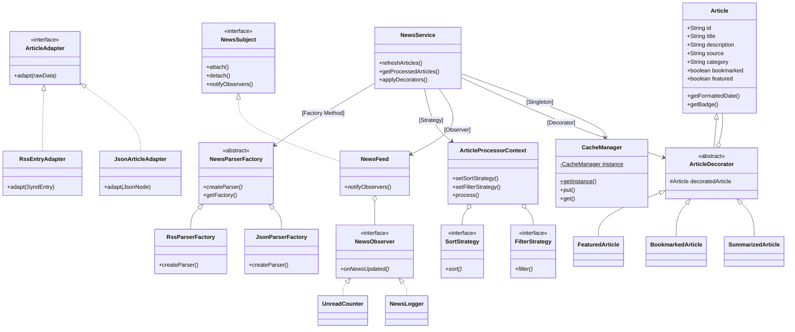
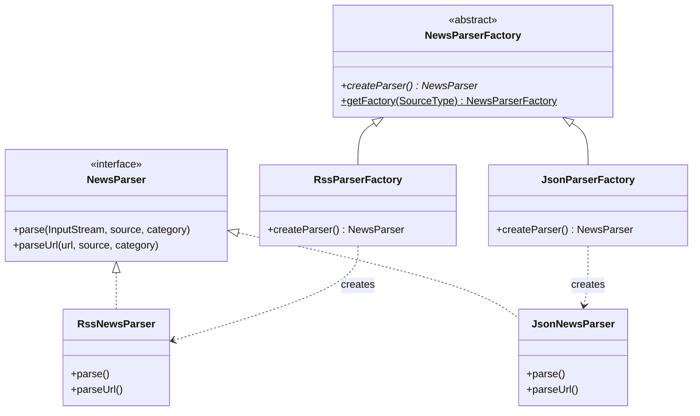
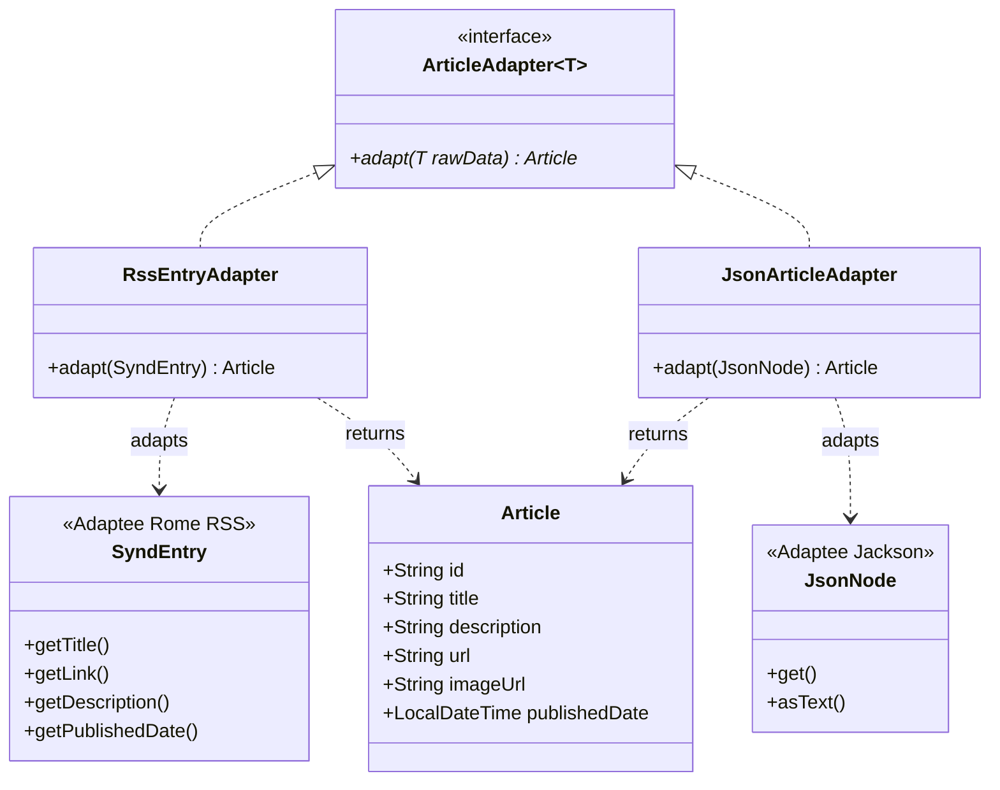
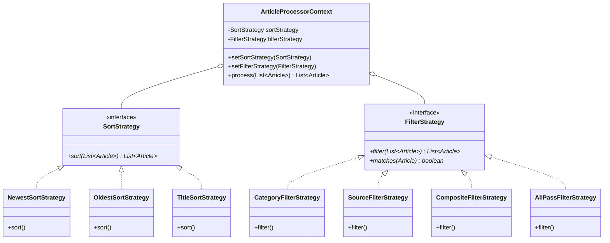
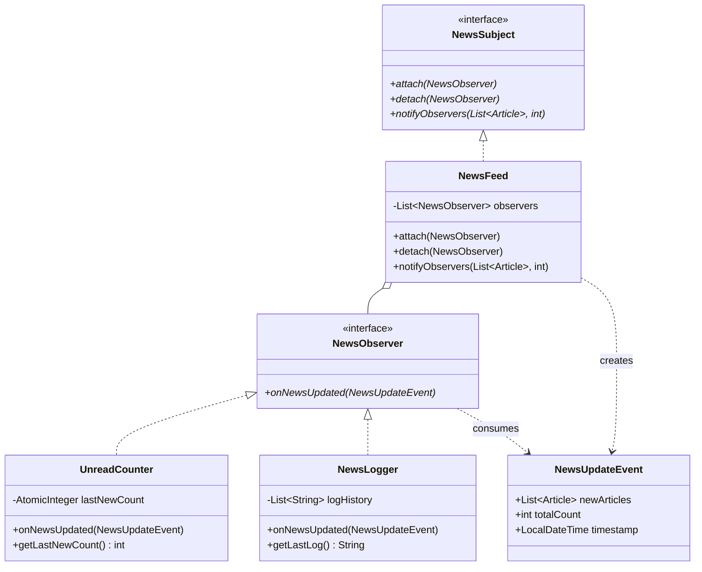
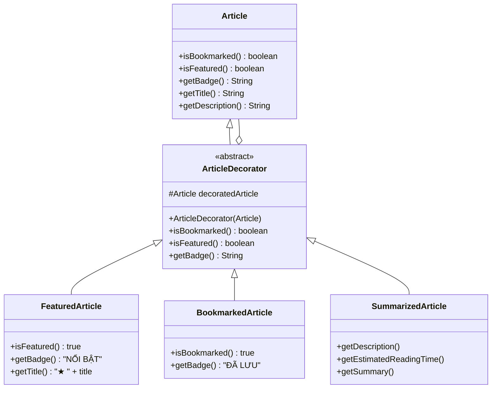
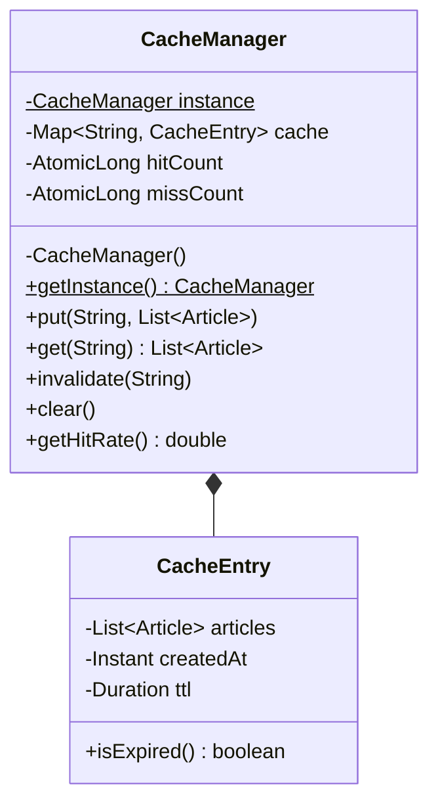

# Thư Mục Sơ Đồ Thiết Kế UML (PlantUML & Mermaid)

Thư mục này chứa toàn bộ sơ đồ lớp và kiến trúc hệ thống phục vụ báo cáo đồ án môn "Mẫu thiết kế".

## Danh Sách File Sơ Đồ PlantUML (.puml)
1. `system-overview.puml`: Sơ đồ kiến trúc toàn hệ thống nối 6 mẫu thiết kế.
2. `factory-method.puml`: Sơ đồ mẫu Factory Method (`NewsParserFactory`).
3. `adapter.puml`: Sơ đồ mẫu Adapter (`RssEntryAdapter`, `JsonArticleAdapter`).
4. `strategy.puml`: Sơ đồ mẫu Strategy (`SortStrategy`, `FilterStrategy`, `ArticleProcessorContext`).
5. `observer.puml`: Sơ đồ mẫu Observer (`NewsFeed`, `UnreadCounter`, `NewsLogger`).
6. `decorator.puml`: Sơ đồ mẫu Decorator (`ArticleDecorator`, `FeaturedArticle`, `BookmarkedArticle`, `SummarizedArticle`).
7. `singleton.puml`: Sơ đồ mẫu Singleton (`CacheManager`).

---

## Sơ Đồ Trực Quan Bằng Mermaid (Hiển thị trực tiếp)

### 1. Sơ Đồ Tổng Thể Hệ Thống (Architecture Overview)

### 2. Mẫu Factory Method

### 3. Mẫu Adapter

### 4. Mẫu Strategy

### 5. Mẫu Observer

### 6. Mẫu Decorator

### 7. Mẫu Singleton

